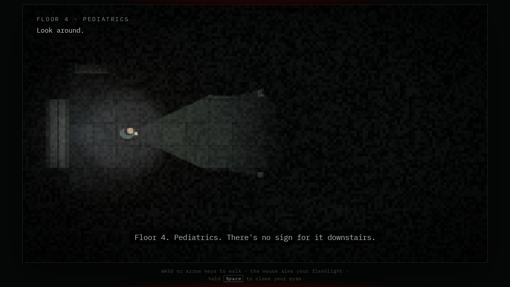

*Disclaimer: this README was generated by AI. I'm honestly terrible at describing my own projects (my first draft is usually just "it does the thing, trust me"), so I let a robot do the explaining.*

# One More Game

A short browser horror game. A hospital floor that isn't on the elevator buttons. A doll that wants one more game. You hide by closing your eyes, and so does the screen. The credits roll halfway through.

## Play

**[Play it in your browser](https://hexa3.github.io/one-more-game/)**

Or open `index.html` in a browser. No build step and no dependencies (fonts load from Google Fonts; all audio is synthesized with Web Audio).

## Controls

- **WASD / arrow keys**: walk
- **Mouse**: aim the flashlight
- **Hold Space**: close your eyes
- On touch devices: on-screen stick and a hold-to-close-eyes button

Headphones recommended. Footsteps are panned left and right.
